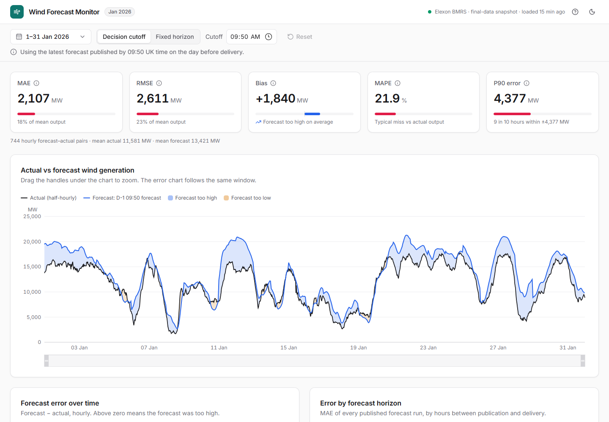

# Wind Forecast Monitor

A web app for a UK day-ahead power buying team. For every hour in **January 2026** it shows the GB wind forecast that was **actually available at decision time** (the day before delivery), compares it with what the wind fleet really generated, and reports how accurate those forecasts were.

**Live app:** [PLACEHOLDER]



- Further reading: [Analysis summary (Jan 2026 findings)](docs/analysis.md), [client pitch script](docs/pitch-client.md), [tech lead walkthrough script](docs/walkthrough-tech-lead.md)

---

## 1. Purpose

Day-ahead power is bought on D-1 for delivery on day D. Wind output is the biggest swing factor in GB supply, so buyers need to know:

1. **What did the wind forecast say when we had to decide?** (not a later, better forecast we could not have used)
2. **How much can we trust it?** Typical error, bias, worst-case misses, and how error grows with lead time.

## 2. Decision-time logic

**Data (Elexon BMRS, no other sources)**

| Dataset | Endpoint | What it is | Resolution |
|---|---|---|---|
| Actuals | `FUELHH/stream`, `fuelType=WIND` | Metered GB wind generation (MW) | 30 min |
| Forecasts | `WINDFOR/stream` | Wind generation forecast (MW), published ~8×/day at 02:30, 04:30, 07:30, 09:30, 11:30, 15:30, 18:30, 22:30 UTC, each covering roughly the next 2-3 days | 1 hour |

**Cutoff mode (default).** For a target hour on day **D**:

1. Cutoff = **09:50 Europe/London on D-1** (configurable hour and minute).
2. Take every forecast for that target hour with `publishTime <= cutoff`.
3. Keep the **latest** of those. That is the forecast a buyer could actually have used.
4. Join it to the actual on the exact `startTime`.

> Example: target **Sat 10 Jan 14:00**. Cutoff = Fri 9 Jan 09:50. The 09:30 run is the latest one published by then, so it is used (lead time 28.5 h). The 11:30 run on 9 Jan arrives after the cutoff and is ignored.

All 24 hours of day D share one cutoff, so in January the 09:50 cutoff always selects the 09:30 run on D-1 (lead times 14.5-37.5 h). The cutoff is built from London wall-clock time, so it stays correct across daylight-saving changes (tested for 29 Mar and 25 Oct 2026).

**Fixed-horizon mode.** Pick H (0-48 h). For each target hour, use the latest forecast published **at least H hours before** it (`publishTime <= startTime - H`). This answers "how good is a forecast H hours out?"

**Error by lead time** uses **every** forecast run for the selected targets (not only the selected ones), bucketed by `startTime - publishTime` in 6-hour bands from 0 to 48 h.

## 3. Metrics

Error convention: **error = forecast − actual** (positive = forecast too high).

| Metric | Definition |
|---|---|
| MAE | mean(\|error\|) |
| RMSE | sqrt(mean(error²)); penalises large misses |
| Bias | mean(error); > 0 means over-forecast on average |
| MAPE | mean(\|error\| / actual) × 100, skipping hours with actual < `MAPE_MIN_ACTUAL_MW` (default 1 MW) to avoid dividing by ~0 |
| P90 absolute error | 90th percentile of \|error\| (linear interpolation): 9 in 10 hours miss by less |

Metrics are computed overall, per day (London date) and per lead-time bucket. The API also generates plain-English **key insights** (bias, typical error, risk sizing, cost of deciding a day ahead, lead-time effect, best/worst day, windy vs calm periods).

## 4. Repository layout

```
.
├── backend/                  FastAPI service (Python 3.11)
│   ├── app/
│   │   ├── main.py           Routes, validation, CORS, error handling
│   │   ├── config.py         Settings (env vars) and fixed Jan-2026 scope
│   │   ├── elexon.py         BMRS client: weekly chunking, retry with backoff
│   │   ├── data_store.py     In-memory + gzipped-JSON disk cache
│   │   ├── forecasting.py    Cutoff / horizon selection, joins (DST-safe)
│   │   ├── metrics.py        MAE, RMSE, bias, MAPE, P90, daily, by-horizon
│   │   ├── insights.py       Plain-English takeaways
│   │   ├── models.py         Pydantic response models
│   │   └── refresh.py        CLI: re-fetch data from Elexon
│   ├── data/                 Committed Jan-2026 snapshot (≈110 KB) for instant startup
│   ├── tests/                pytest: selection, metrics, API, client retries
│   ├── Dockerfile, Procfile, requirements*.txt, .env.example
├── frontend/                 React + Vite + TypeScript + Recharts
│   ├── src/
│   │   ├── App.tsx           Page layout and state
│   │   ├── api.ts, types.ts  Typed API client
│   │   ├── useDashboard.ts   Fetching (abortable, keeps data while refetching)
│   │   ├── components/       Controls, MetricCards, ForecastChart, ErrorChart,
│   │   │                     HorizonChart, Insights, DailyTable (CSV export)
│   │   └── lib/              Formatting, CSV, axis helpers
│   ├── Dockerfile, nginx.conf.template, vercel.json, .env.example
├── docs/                     Analysis summary, pitch and walkthrough scripts, screenshot
├── docker-compose.yml        Runs backend + frontend together
├── render.yaml               Render blueprint for the API
└── .env.example              All environment variables in one place
```

## 5. API

Base URL: `http://localhost:8000`. Interactive docs at `/docs`. Dates are London-local target dates (`YYYY-MM-DD`, inclusive) limited to 2026-01-01..2026-01-31.

| Endpoint | Parameters | Returns |
|---|---|---|
| `GET /api/health` | none | Load status, data source, row counts |
| `GET /api/actuals` | `start`, `end` | Half-hourly wind outturn |
| `GET /api/forecasts/latest` | `start`, `end`, `mode=cutoff\|horizon`, `cutoff_hour` (0-23), `cutoff_minute` (0-59), `horizon_hours` (0-48) | Selected forecast per target hour, with publish time and lead time |
| `GET /api/metrics` | same as above, plus `include_points` (default true) | Overall + daily metrics, coverage, joined series, insights |
| `GET /api/error-by-horizon` | `start`, `end`, `bucket_hours` (default 6), `max_horizon` (default 48) | Metrics per lead-time bucket over all forecast runs |

If `mode` is omitted, passing `horizon_hours` selects horizon mode; otherwise cutoff mode. Invalid input returns **422** with a clear message, and **503** means the data could not be loaded (see `/api/health`).

```bash
curl "http://localhost:8000/api/metrics?start=2026-01-10&end=2026-01-16&cutoff_hour=9&cutoff_minute=50&include_points=false"
curl "http://localhost:8000/api/forecasts/latest?start=2026-01-10&end=2026-01-10&horizon_hours=24"
```

## 6. Run locally

### With Docker

```bash
docker compose up --build
# Frontend: http://localhost:8080   API: http://localhost:8000/docs
```

nginx in the frontend container proxies `/api` to the backend service, so there is no CORS setup.

### Without Docker

Backend (Python 3.11+):

```bash
cd backend
python -m venv .venv
source .venv/bin/activate          # Windows: .venv\Scripts\activate
pip install -r requirements-dev.txt
uvicorn app.main:app --reload --port 8000
pytest                             # 35 tests
python -m app.refresh              # optional: re-fetch Jan-2026 data from Elexon
```

Frontend (Node 20.19+ or 22.12+):

```bash
cd frontend
npm install
npm run dev                        # http://localhost:5173 (proxies /api to :8000)
npm run build                      # type-check + production build
```

## 7. Deploy (Vercel frontend + Render backend)

1. **Push to GitHub.**
   ```bash
   git remote add origin https://github.com/<you>/wind-forecast-monitor.git
   git push -u origin main
   ```
2. **Backend on Render.** Dashboard → **New → Blueprint** → pick the repo (uses `render.yaml`). Or **New → Web Service** with:
   - Root directory `backend`, runtime **Python 3**
   - Build `pip install -r requirements.txt`
   - Start `uvicorn app.main:app --host 0.0.0.0 --port $PORT`
   - Health check path `/api/health`
   - Env vars: `PYTHON_VERSION=3.11.9`, `ALLOWED_ORIGINS=https://<your-app>.vercel.app` (fill in after step 3), optionally `ALLOWED_ORIGIN_REGEX=https://<your-app>-.*\.vercel\.app` for preview deploys.

   Check that `https://<service>.onrender.com/api/health` returns `"status":"ok"`. (You can also choose the **Docker** runtime with `backend/Dockerfile`.)
3. **Frontend on Vercel.** **Add New → Project** → import the repo, then:
   - Root directory `frontend` (framework preset Vite, build `npm run build`, output `dist`)
   - Env var `VITE_API_URL=https://<service>.onrender.com`

   Or use the CLI: `cd frontend && vercel --prod` (set `VITE_API_URL` with `vercel env add VITE_API_URL production` first).
4. Set `ALLOWED_ORIGINS` on Render to the final Vercel URL and redeploy the backend.
5. Replace the **Live app** placeholder at the top of this README.

**Heroku alternative for the backend:** `heroku create`, `heroku config:set ALLOWED_ORIGINS=https://<your-app>.vercel.app`, `git subtree push --prefix backend heroku main` (uses `backend/Procfile` and `.python-version`).

### Environment variables

| Variable | Where | Default | Purpose |
|---|---|---|---|
| `ALLOWED_ORIGINS` | backend | `http://localhost:5173,http://localhost:3000` | Comma-separated CORS origins (`*` = any) |
| `ALLOWED_ORIGIN_REGEX` | backend | unset | Extra CORS origins by regex (e.g. Vercel previews) |
| `REFRESH_ON_STARTUP` | backend | `false` | `true` re-fetches from Elexon at startup instead of using `data/` |
| `ELEXON_BASE_URL` | backend | `https://data.elexon.co.uk/bmrs/api/v1` | BMRS API base |
| `REQUEST_TIMEOUT_S`, `MAX_RETRIES` | backend | `30`, `4` | Elexon client behaviour (exponential backoff on 429/5xx/network errors) |
| `DEFAULT_CUTOFF_HOUR`, `DEFAULT_CUTOFF_MINUTE` | backend | `9`, `50` | Default D-1 cutoff when the query omits it |
| `MAPE_MIN_ACTUAL_MW` | backend | `1` | MAPE zero-guard threshold |
| `PYTHON_VERSION` | Render | `3.11.9` | Python runtime on Render |
| `VITE_API_URL` | frontend (build time) | empty | Backend base URL; empty = same-origin `/api` |
| `BACKEND_URL` | frontend Docker | `http://backend:8000` | nginx `/api` proxy target |

## 8. Assumptions and limitations

Assumptions confirmed with the product owner before the metrics were built:

- **Exact-hour join.** WINDFOR is hourly and FUELHH half-hourly, so metrics use the 744 on-the-hour points where both exist. Nothing is interpolated or averaged. The chart still shows all half-hourly actuals.
- **Error = forecast − actual**, so positive bias means over-forecasting.
- **Error by lead time uses all forecast runs**, not only the cutoff-selected ones; otherwise the 09:50 cutoff would only cover 14-38 h.

Other assumptions:

- **Cutoff 09:50 London time on D-1**, as given in the brief (it lines up with GB day-ahead auction gate closure). If your desk decides at another time, change it in the UI or API. Day D is the London-local date of the target hour, and the cutoff is inclusive (`publishTime <= cutoff`).
- **Target hours with no eligible forecast are excluded** and reported as a coverage gap. With H = 48 h, about 20% of hours have no forecast, because each run only reaches ~21:00 UTC two days ahead.
- **Duplicates:** for FUELHH the latest `publishTime` per `startTime` wins; WINDFOR is de-duplicated on (`publishTime`, `startTime`).

Limitations:

- **One winter month.** Results may not hold in other seasons or wind regimes.
- **Definitions may differ between datasets.** FUELHH is metered output, including the effect of any curtailment, while WINDFOR is a forecast of generation. Part of the strong positive bias may reflect curtailment or differences in which wind farms each dataset covers, not only forecasting skill. This cannot be verified with Elexon wind data alone (per scope).
- **MAPE is inflated on calm days** (e.g. 66% on 8 Jan, when mean output was 4.5 GW); prefer MAE/P90 for sizing.
- **Static snapshot.** January 2026 is final, so the data is committed for speed and resilience; `python -m app.refresh` or `REFRESH_ON_STARTUP=true` re-fetches it.
- **Free-tier hosting** (Render) sleeps when idle; the first request can take 30-60 s, and the UI shows a "waking up" message.
- Docker images were written to standard patterns but **not built in the authoring environment** (Docker was unavailable there); the non-Docker path was run end to end.

## 9. AI assistance

This project was built with the help of AI tools: **Claude (Anthropic)**, used through Claude Code for data exploration, code, tests and documentation. Metric definitions and modelling assumptions were confirmed by the author, and the outputs were checked against the live Elexon data and an automated test suite.
